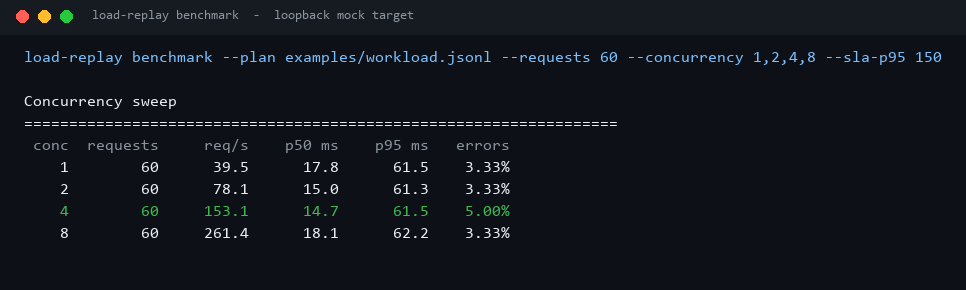
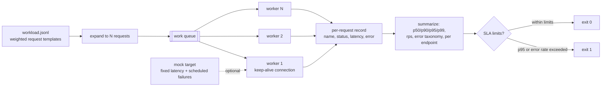
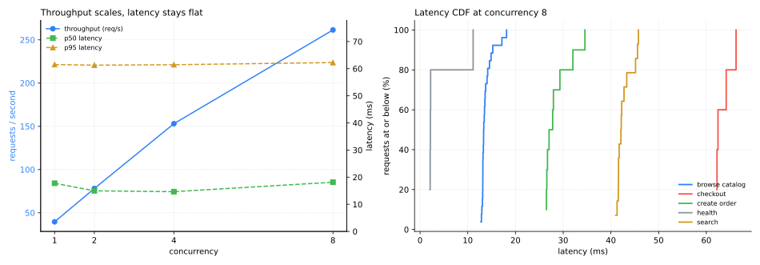

# HTTP-Load-Replayer

[](https://github.com/abubakarsiddique360/HTTP-Load-Replayer/actions/workflows/ci.yml)


Describe production traffic as a weighted JSONL file, replay it against any HTTP target, and get
latency percentiles, throughput, an error taxonomy and an exit code your CI can act on. A
deterministic mock target is bundled so the experiment runs offline.

```json
{"name": "browse catalog", "method": "GET", "path": "/api/catalog", "weight": 6}
{"name": "checkout", "method": "POST", "path": "/api/checkout", "body": {"cart": "c-77"}, "weight": 1}
```

## The sweep



## Why it exists

Load tests usually answer one question - "how many requests per second" - with a tool that needs a
cluster, a config language and a dashboard. The questions that decide a release are smaller: what
does p95 do at twice the concurrency, which endpoint owns the tail, and which failures are transport
errors rather than HTTP 5xx.

This tool replays a *request mix* (weights, methods, bodies), keeps one connection per worker like a
real client, and reports the distribution instead of an average. The bundled mock target makes the
whole experiment reproducible: fixed endpoint latencies, a 429 every seventh search, a 500 every
eleventh checkout.

## How it works



Each worker owns an `http.client` connection, so the run measures keep-alive behaviour instead of
handshake cost. A request that fails at the socket level is recorded as a transport error with its
exception class, which is the difference between "the service is slow" and "the service is not
listening".

## Results from the committed sweep

60 requests per level against the bundled mock target on a loopback interface, Windows 11 /
Python 3.11:

| Concurrency | Throughput | p50 | p95 | p99 | Error rate |
| ---: | ---: | ---: | ---: | ---: | ---: |
| 1 | 39.5 req/s | 17.8 ms | 61.5 ms | 61.6 ms | 3.33% |
| 2 | 78.1 req/s | 15.0 ms | 61.3 ms | 61.6 ms | 3.33% |
| 4 | 153.1 req/s | 14.7 ms | 61.5 ms | 61.7 ms | 5.00% |
| 8 | 261.4 req/s | 18.1 ms | 62.2 ms | 64.2 ms | 3.33% |



Throughput scales almost linearly from 39 to 261 requests per second while p95 stays at ~62 ms.
That flat p95 is the mock's 60 ms checkout endpoint: the tail is a property of the workload mix, not
of the load, and mixing endpoints is exactly why a single "average latency" hides it. The CDF shows
the same thing from the other side - each endpoint's calls cluster at its own think time.

The 3.33% error rate is by design: 2 of 60 requests hit `/api/search` on its 7th-call boundary and
receive a 429. The replayer reports those as `4xx`, not as transport failures.

## Install

```bash
pip install -e .
```

Python 3.10+, standard library only.

## Usage

```bash
load-replay validate  --plan examples/workload.jsonl
load-replay mock      --port 8099                          # bundled target, Ctrl+C to stop
load-replay replay    --plan examples/workload.jsonl --url http://127.0.0.1:8099 --requests 200
load-replay replay    --plan examples/workload.jsonl --url http://127.0.0.1:8099 \
                      --requests 200 --concurrency 8 --sla-p95 150 --sla-error-rate 2
load-replay benchmark --plan examples/workload.jsonl --requests 60 --concurrency 1,2,4,8
load-replay benchmark --format markdown --sla-p95 150      # paste into a PR comment
```

Exit codes: `0` all SLA checks passed (or no SLA given), `1` a check failed, `2` bad plan or
arguments. `benchmark` starts and stops the mock target itself.

## The plan format

One JSON object per line; `#` comments and blank lines are ignored.

| Field | Required | Notes |
| --- | --- | --- |
| `name` | yes | unique label used in the per-endpoint report |
| `method` | no | `GET` (default), `POST`, `PUT`, `PATCH`, `DELETE`, `HEAD` |
| `path` | yes | must start with `/`, may include a query string |
| `weight` | no | integer >= 1, default 1; proportions requests across the mix |
| `headers` | no | object of string values, merged over the defaults |
| `body` | no | JSON object, serialised and sent with `Content-Type: application/json` |

`validate` prints the weight mix before you send a single request:

```text
plan ok: examples/workload.jsonl (5 request templates, total weight 13)
name                    method   weight   share  path
browse catalog          GET           6   46.2%  /api/catalog
search                  GET           3   23.1%  /api/search?q=drill
create order            POST          2   15.4%  /api/orders
```

## The report

Text output includes the latency distribution, response classes, transport errors, a per-endpoint
table and every SLA check:

```text
requests      60   concurrency 8
wall          0.229 s   throughput 261.44 req/s
failures      2 (3.33%)

Latency (ms)      avg      p50      p90      p95      p99      max
                  22.4     18.1     42.1     62.2     64.2     66.2

endpoint                 requests  failures      p50      p95
browse catalog                 26         0     13.3     17.2
checkout                        5         0     62.4     66.2
search                         14         2     42.1     45.6
```

`--format json` returns the same structure for a dashboard, including `classes`, `statuses`,
`transport_errors`, `latency`, `endpoints` and `sla`.

## Design notes and limits

- **Closed-loop replay.** N workers keep N requests in flight; the plan does not reproduce
  open-model arrival rates. A slow target therefore reduces offered load, which is honest but not
  the same as a constant-rate generator.
- **No retries.** A failed request stays failed. Retrying would hide exactly the error rate the
  tool exists to measure.
- **Latency is measured around the request/response, not the TCP handshake**, except for the first
  request on a fresh connection, which includes connect time.
- **The mock is a fixture, not a benchmark of your service.** Fixed sleeps mean small absolute
  numbers; the shape of the curves is what the experiment demonstrates.
- **Single process.** The client shares one GIL, so beyond a few hundred requests per second the
  replayer itself becomes part of the measurement. Run several processes with different plans if you
  need more pressure.

## Development

```bash
python -m pip install -e ".[dev]"
ruff check .
pytest                                # 47 tests, all on loopback
python scripts/render_assets.py       # regenerate docs/benchmark.json and docs/images
```

## License

MIT - see [LICENSE](LICENSE).
